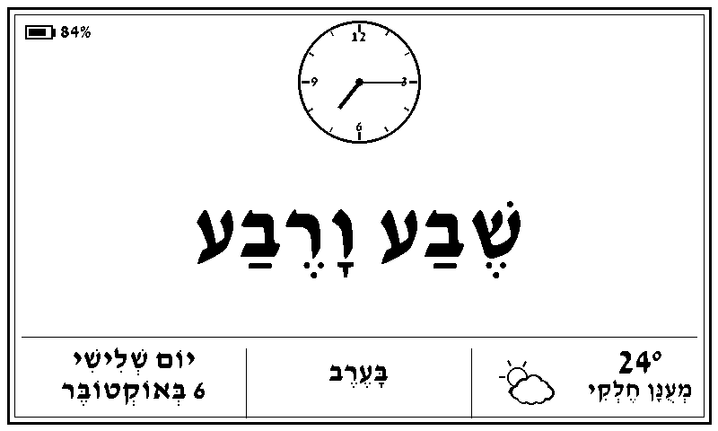
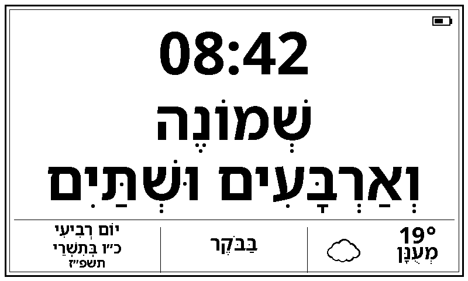
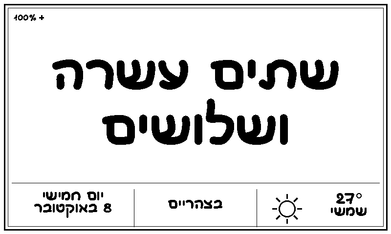
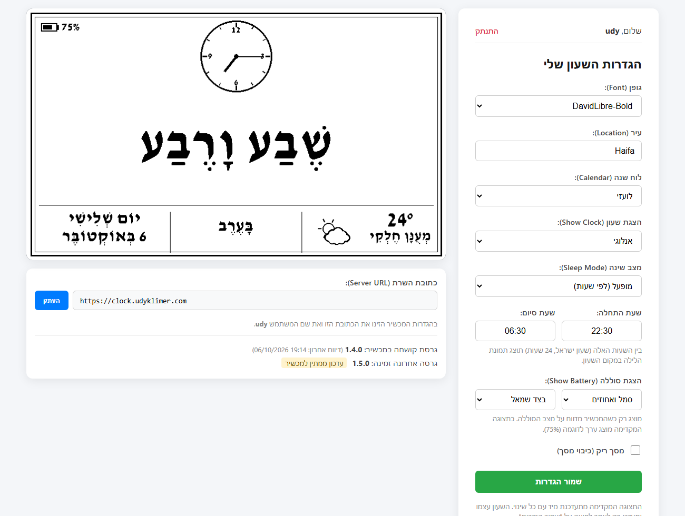

# hebrew-clock


A Hebrew word-clock server for e-paper displays. It renders the current Israel time in written Hebrew (e.g. *שֶׁבַע וָרֶבַע בָּעֶרֶב*, "quarter past seven in the evening") as an 800×480 black-and-white PNG, together with a clock, the date and the local weather. An e-paper device fetches that image once a minute and shows it.

> **Based on [t0mer/hebrew-clock](https://github.com/t0mer/hebrew-clock) by Tomer Klein.**
> This repository is a fork of that project. The image rendering, the weather and Hebrew-calendar services and the original ESP32 sketch come from there. See [What this fork adds](#what-this-fork-adds) for the differences.

---

## What this fork adds

- **User accounts.** Each user registers on the website and gets their own saved clock settings.
- **Settings page with live preview.** Font, city, calendar, clock style, sleep hours, battery display and blank screen, with a preview image that updates as you change them.
- **One URL per device.** The device asks for `/clock.png?user=<name>` and the server applies that user's saved settings, so the look of the clock is changed from the website, not on the device.
- **Several devices per user.** Each device reports its own ID; the settings page lists them with name, firmware, battery and last report, and any device can have its own settings.
- **Four clock languages.** Hebrew, English, French and Spanish, each written the way people say the time ("Quarter To Eight", "Huit Heures Moins Le Quart", "Las Ocho Menos Cuarto"). In English, French and Spanish every word on the display starts with a capital letter.
- **Settings page in Hebrew or English,** switched with the flags at the top.
- **Clock style.** Analog face, digital `HH:mm`, or no clock (larger text only).
- **Sleep hours.** The night image is shown between a start and end time that each user sets.
- **Battery indicator.** The device reports its battery voltage and the server draws an icon, a percentage or both in a top corner.
- **Blank screen mode.** Returns an all-white image.
- **More fonts.** Fonts are picked up from the `fonts/` folder. Fonts without vowel marks (nikud) are supported: the text is drawn unvowelized, in its full spelling, instead of showing empty boxes. Text is sized to stay inside its area in every font.
- **Persistent data.** Users and settings live in a SQLite file under `DATA_DIR` (`/data` in Docker), so they survive image updates.
- **Exact daylight-saving time**, taken from the `Asia/Jerusalem` time-zone database.
- **New firmware** for the TRMNL DIY kit, in a separate repository: [udyklimer/trmnl-hebrew-clock](https://github.com/udyklimer/trmnl-hebrew-clock).

---

## How it works

1. You register at the server's home page and choose your settings on the settings page.
2. The device wakes once a minute and downloads `<server>/clock.png?user=<your user name>`.
3. The server renders the current time with your saved settings and returns a 1-bit 800×480 PNG.
4. The device shows the image and goes back to sleep.

---

## Display

The image has three parts: an optional clock at the top, the time in Hebrew words in large text, and a bottom bar with the day and date, the time of day (*בַּבֹּקֶר*, *בָּעֶרֶב*, …) and the weather. A battery indicator can be added in a top corner.

Analog clock, with the battery shown as icon and percentage:



Digital clock, with the Jewish calendar date in the bottom-left cell:



No clock, only the text, in a font without nikud (the words switch to their full spelling). The `+` after the percentage means the device is charging:



Sleep mode shows a night image instead of the clock:


---

## Settings

Log in at the server's home page to reach the settings page.



| Setting | Options | Notes |
|---------|---------|-------|
| Clock language | עברית / English / Français / Español | The language of the time, date, weather and night screen. |
| Font | fonts that can write the chosen language | See [Fonts](#fonts). The list changes with the clock language and shows each font's own name (e.g. "Open Sans", "Anka CLM"). |
| Location | city name | Used for the weather (from [wttr.in](https://wttr.in)). |
| Calendar | Gregorian / Jewish | The Jewish date comes from [hebcal.com](https://www.hebcal.com). |
| Show Clock | Analog / Digital / None | Digital shows `HH:mm`; None leaves only the Hebrew text, drawn larger. |
| Sleep Mode | off / on, with start and end time | When on, the night image is shown between the two times (Israel time, 24-hour `HH:MM`; the range may cross midnight). The same start and end time means all day. |
| Show Battery | none / icon / percentage / both, left or right | Drawn in a top corner. Appears only when the device reports its battery. |
| Battery Save | 1–15 minutes | How often the device connects. With N above 1 it downloads the images for the next N minutes at once and shows them one per minute, so it uses Wi-Fi N times less. Settings, weather and battery level then update only every N minutes. |
| Bottom row | show / hide | The row with the date, time of day and weather. Hidden, the time text uses the freed space, and the weather and Hebrew date are not fetched. |
| Screen shades | black and white / 4 shades of gray | Gray smooths the edges of letters. It needs firmware that drives the panel in gray mode; older firmware shows the gray image in black and white. |
| Blank screen | off / on | On returns an all-white image. |

The preview next to the form shows your choices immediately. The device only changes after you press **Save**. On a phone the preview sits at the top of the page and stays in view while you scroll through the settings.

### Several devices

With a single device the settings page looks as before: there is no device list, and the device always uses the shared settings. Once a second device connects, devices whose firmware sends a device ID (see `device` under [Image endpoint](#image-endpoint)) appear under **My devices** on the settings page, each with its ID, firmware version, battery level and last report. You can give each one a name ("Kitchen") or remove it from the list; a removed device that connects again reappears with the shared settings.

By default every device of a user draws with the same settings. To give one device its own, pick it under **Settings for**, tick **Separate settings for this device**, change what you want and save. Untick the box to make it follow the shared settings again. A user can have up to 20 devices; when a new one connects beyond that, the one seen longest ago is dropped from the list. A device that is set up for a different user moves to that user and starts with the shared settings.

The page also shows the **Server URL**. Enter that address and your user name in the device's setup portal.

---

## Image endpoint

```
GET /clock.png?user=<name>
```

Returns `image/png`, 800×480, 1-bit, with `Cache-Control: no-cache`. `/clock` is an alias.

With `user`, the saved settings of that user are applied. Any of the parameters below can be added to override a setting for one request; this is how the settings page builds its preview. Without `user`, the defaults are used.

| Parameter | Values | Default |
|-----------|--------|---------|
| `language` | `he`, `en`, `fr`, `es` | `he` |
| `font` | a font name from `fonts/`, without `.ttf`; a font that cannot write the language is replaced by the default | `DavidLibre-Bold` |
| `location` | city name | `Haifa` |
| `calendar` | `gregorian`, `jewish` | `gregorian` |
| `clock_style` | `analog`, `digital`, `none` | `analog` |
| `sleeptime` | `0`, `1` | `0` |
| `sleep_start`, `sleep_end` | `HH:MM` (24-hour) | none: `sleeptime=1` given in the URL without them shows the night image at any hour |
| `blank` | `0`, `1` | `0` |
| `battery_display` | `none`, `icon`, `percent`, `both` | `none` |
| `battery_position` | `left`, `right` | `left` |

For battery save mode, a device can ask for a specific minute instead of the current one:

| Parameter | Values | Meaning |
|-----------|--------|---------|
| `at` | Unix time in seconds | Render the clock for the minute containing this moment. Must be within 10 minutes before and 30 minutes after the server's time. |
| `bottom_bar` | `0`, `1` | `0` hides the bottom row (date, time of day, weather). Defaults to the user's **Bottom row** setting. |
| `gray` | `0`, `1` | `1` returns 4 shades of gray (a 2-bit PNG with levels 0, 85, 170, 255) so text edges are smoothed; `0` returns black and white. Defaults to the user's **Screen shades** setting. Every image response carries `X-Gray-Levels: 4` or `2`. |
| `device` | 4–40 letters, digits, `-` or `_`, e.g. the chip's MAC address `7c9ebd4a12f0` | Identifies the device (case-insensitive). With `user`, the server records the device's firmware, battery and last report, and uses the device's own settings if it has them. |

Every image response carries `X-Batch-Minutes: <N>`, the user's battery save setting, so the device knows how many minutes to fetch per connection.

A device can report its battery on each request, and the server draws it according to the user's battery setting:

| Parameter | Values | Meaning |
|-----------|--------|---------|
| `battery_mv` | millivolts, e.g. `4063` | Battery voltage; the server converts it to a percentage with a LiPo curve. |
| `battery` | `0`–`100` | Battery percentage, if the device prefers to compute it. Takes priority over `battery_mv`. |
| `charging` | `0`, `1` | `1` adds a `+` next to the battery. |

The image endpoint needs no login: anyone who knows a user name can fetch that user's clock image.

### Firmware updates

A device can report its firmware version with `fw=<version>` (e.g. `fw=1.4.0`) on the image request. The server checks the latest release of the firmware repository on GitHub (at most once an hour). If it is newer, the image response carries these headers and the device can update itself:

| Header | Meaning |
|--------|---------|
| `X-Firmware-Version` | The newer version, e.g. `1.5.0`. |
| `X-Firmware-Url` | Where to download it on this server: `/firmware/<version>.bin`. |
| `X-Firmware-Size` | Size in bytes. |
| `X-Firmware-Sha256` | SHA-256 of the file, as hex. |
| `X-Firmware-Signature` | Base64 of the release's ECDSA P-256 signature of the file. |

The latest available release is shown on the settings page, and each device in **My devices** shows its own version, marked when an update is waiting. For devices that don't send a `device` ID, the page shows the version last reported by any of the user's devices.

Each release must be tagged `v<major>.<minor>.<patch>` and have two assets: `firmware.bin` and `firmware.bin.sig` (the DER signature). The server downloads both into `DATA_DIR/firmware/` the first time a device needs them. The device checks the signature against the public key built into it, so the server never holds the signing key and cannot make a device accept firmware that was not signed with it.

Other routes: `/health`, `/robots.txt`, `/sitemap.xml`, and interactive API docs at `/api/docs`.

---

## Fonts

Fonts are kept in folders by alphabet:

| Folder | Fonts | Languages |
|--------|-------|-----------|
| `fonts/common/` | Have Hebrew (with vowel marks) and Latin with accents: Assistant, David Libre, Frank Ruhl Libre, Heebo, Noto Sans Hebrew, Open Sans, Playpen Sans Hebrew, Rubik | all four |
| `fonts/hebrew/` | Hebrew only, mostly without vowel marks: Anka, Comix No2, Gan, Makabi, Noot, Stopmotion | Hebrew (Makabi and Noot also English) |
| `fonts/latin/` | Latin with accents: Lato, Merriweather, Montserrat, Poppins, Roboto | English, French, Spanish |

The folders are only for order. For each language the server checks which fonts contain every letter that language's clock texts use (for example ñ for Spanish, ç and è for French), and the settings page lists only those. To add a font, drop the `.ttf` file into the matching folder and restart the server (or rebuild the image).

The settings page shows each font by the family name stored inside the font file, with each word capitalised ("Open Sans", "Anka CLM"). The style is added only when two fonts share a family ("Comix No2 CLM Bold", "Comix No2 CLM Medium"), and a font without a stored name is shown by a cleaned-up file name. The saved setting and the `font` URL parameter still use the file name without `.ttf`.

A font does not have to be complete. If it lacks vowel marks, the geresh marks used in Hebrew dates, the minus sign, the degree sign, the colon or the percent sign, the server drops, replaces or draws those itself. For a font with no vowel marks, Hebrew words are written in their full unpointed spelling (for example מעונן, בבוקר, שתיים).

The Google fonts were added as fixed bold versions of the variable fonts from [Google Fonts](https://github.com/google/fonts); their licenses are in `fonts/licenses/`. All bundled fonts keep their own licenses (SIL Open Font License or GNU GPL, as stated inside each font file).

---

## Running with Docker

Images are published to the GitHub Container Registry by the manual "Publish to GHCR" workflow:

```
ghcr.io/udyklimer/hebrew-clock:latest
```

With Docker Compose (the file is in the repo and builds locally):

```bash
docker compose up -d
```

With `docker run`:

```bash
docker run -d -p 8765:8765 -v hebclk-data:/data ghcr.io/udyklimer/hebrew-clock:latest
```

**Keep the `/data` volume.** It holds `clock.db` (users and settings) and the key that signs login cookies. Without a volume mounted at `/data`, both are lost whenever the container is recreated.

The container runs as user ID 10001. If you mount a host folder at `/data`, that folder must be writable by the user the container runs as.

### TrueNAS SCALE

In the app's settings, under **Storage → Host Path Volumes**, add a dataset inside your pool (not the pool root) with mount path `/data`. Then make the container able to write to it: either give the dataset to user ID 10001, or set the app's run-as user and group to the owner of the dataset (for example `568`, the built-in `apps` user).

### Environment variables

| Variable | Default | Description |
|----------|---------|-------------|
| `DATA_DIR` | project root (`/data` in Docker) | Folder holding `clock.db` and the generated cookie key. |
| `SECRET_KEY` | generated | Key that signs login cookies. If unset, one is generated and stored in `DATA_DIR/.secret_key`. |
| `DISPLAY_LAG` | `8` | Seconds added to the current time before rendering, to allow for the display's refresh time. |
| `PORT` | `8765` | Port used when the app is started with `python -m app.main`. The Docker image always listens on 8765. |
| `FONT_DIR` | project root | Folder containing `sleeping.png`, the picture used in the night image. |
| `WTTR_URL` | `https://wttr.in` | Base URL of the weather service. |
| `FIRMWARE_REPO` | `udyklimer/trmnl-hebrew-clock` | GitHub repository whose releases provide device firmware. Set it to an empty value to turn updates off. |
| `FIRMWARE_GITHUB_TOKEN` | unset | GitHub token, only needed if the firmware repository is private. |
| `GTAG_ID` | unset | Google Analytics ID. |
| `FORWARDED_ALLOW_IPS` | `*` | Proxies trusted for the `X-Forwarded-Proto` header. Narrow this when self-hosting behind a known proxy. |

---

## Running locally

```bash
pip install -r requirements.txt
python -m uvicorn app.main:app --port 8765
```

Then open `http://localhost:8765`.

Hebrew text needs the Raqm text-shaping support in Pillow. The Docker image has it. On Windows, Pillow only enables it when a FriBiDi library (`fribidi.dll`, `fribidi-0.dll` or `libfribidi-0.dll`) can be found, for example next to `python.exe`; without it the Hebrew is drawn in the wrong direction. Check with:

```bash
python -c "from PIL import features; print(features.check('raqm'))"
```

To run the tests:

```bash
pip install -r requirements-dev.txt
python -m pytest
```

---

## Device firmware

- **TRMNL DIY kit (Seeed XIAO ESP32-S3, 7.5" panel):** [udyklimer/trmnl-hebrew-clock](https://github.com/udyklimer/trmnl-hebrew-clock). This is the firmware written for this fork. Its setup portal asks for a user name and the server URL.
- **Original sketch (Seeed XIAO ESP32C3, Waveshare 7.5" V2):** kept from the upstream project in [sketch/hebclk.ino](sketch/hebclk.ino) and described in [epaper.md](epaper.md). It keeps its settings on the device and sends them as URL parameters. To use it with this server, set its Image URL to `https://<server>/clock.png`.

---

## Project structure

```
app/
  main.py              # FastAPI app
  api/v1/router.py     # Pages (login, settings) and the image endpoint
  core/config.py       # Settings from environment variables
  core/security.py     # Password hashing and signed login cookies
  db.py                # SQLite storage for users and their settings
  services/
    clock.py           # Image generation (layout, fonts, drawing)
    languages/         # Clock texts per language: he, en, fr, es
    ui_text.py         # Settings and login page texts, Hebrew and English
    weather.py         # wttr.in weather, cached
    jewish_cal.py      # hebcal.com Hebrew date, cached
    seo.py             # robots.txt and sitemap.xml
  templates/           # Login page and settings page
fonts/                 # Fonts by alphabet: common/, hebrew/, latin/ (+ licenses/)
sketch/hebclk.ino      # Original ESP32 sketch from the upstream project
tests/
Dockerfile
docker-compose.yml
```

---

## Credits and license

The original project is [t0mer/hebrew-clock](https://github.com/t0mer/hebrew-clock) by Tomer Klein. This fork is maintained by Udy Klimer.

Licensed under the Apache License 2.0; see [LICENSE](LICENSE).
